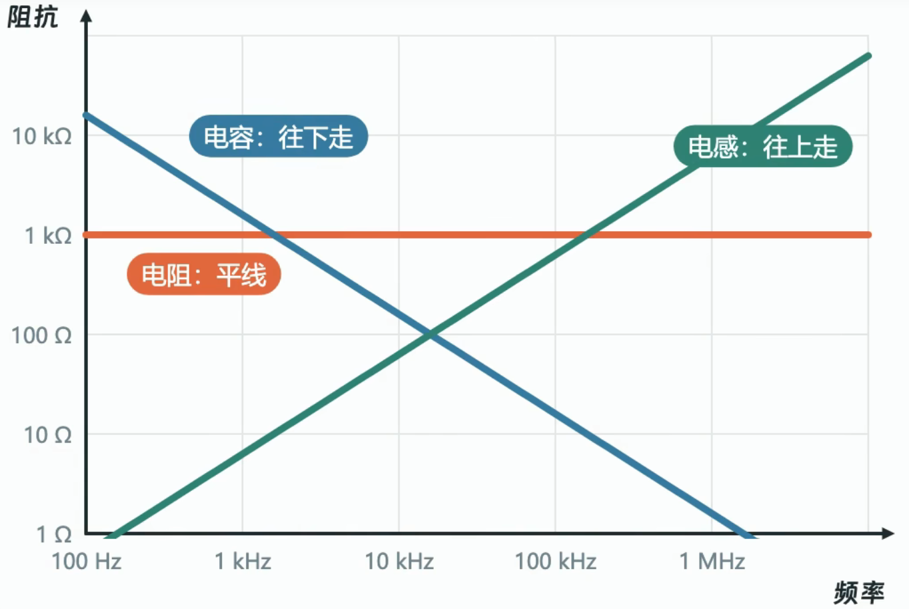
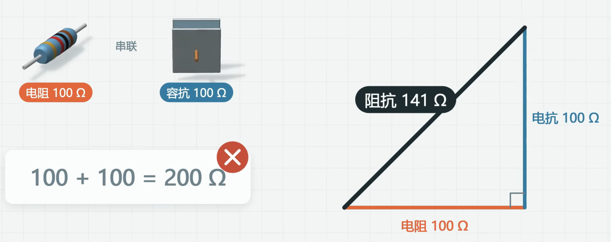

# 一、阻抗的概念
在交流信号下，器件会表现出阻抗特性。在不同的交流频率下，器件表现出的阻抗不同。
$$
Z=\frac{U}{I}
$$
阻抗=电阻+电抗。电阻部分对于直流、交流信号的表现都是相同的。电抗部分的来源是电容与电感，只对变化的信号起作用。这里的电容电感并不只是电容电感这个器件，也包括PCB走线或者其他器件产生的寄生电容、寄生电感（ESC、ESL）。

电容的电抗特性：电容具备隔直通交的性质，对于频率越高的信号，电容表现的“阻力”越小，对应的电抗越小。公式如下：
$$
X_C=\frac{1}{2\cdotπ\cdot f\cdot C}
$$
电容的阻抗标准：1uF--1kHZ--160ou。  

电感的电抗特性：电感具备隔交通直的性质，对于频率越高的信号，电感表现的“阻力”越打，对应的电抗越大。公式如下：
$$
X_L={2\cdotπ\cdot f\cdot L}  
$$
电感的阻抗标准：1mH--1kHZ--6.3ou。

# 二、阻抗的计算
对于电容和电感，电流和电压存在0.25π的相位差，不可以直接相加。需要使用三角法。  

# 三、谐振
电容和电感随频率变化的曲线方向相反，因此对于任意一个电容和电感，一定存在一个二者曲线的交点，交点值的交流频率就是谐振频率。  
（1）电容与电感串联，在谐振时，阻抗最低。  （2）电容和电感并联，在谐振时，阻抗最高。  

真实的电感中存在寄生电容，电容中也有寄生电感。一般在厂家的数据手册中会给出阻抗随频率的变化曲线。在特征曲线发生变化的转折点就是自谐振频率，一旦超过这个频率，电感的表征就近似电容，电容的表征近似电感。这时的阻抗就是ESR。

# 四、导线的阻抗

