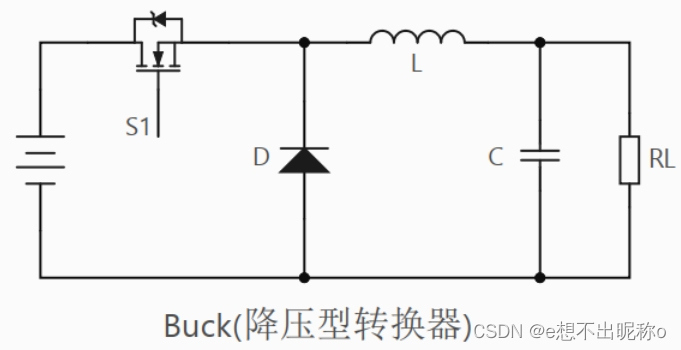

# 总语
本文是一篇个人学习总结。参考来自《精通开关电源设计（第二版）》

# 第一章  概述

## 1.1 效率

对于电源变换系统，至关重要的参数就是效率。转换效率意味着能源的使用成本，产品的工作续航，对外的散热等指标。
$$
η=\frac{Pout}{Pin}
$$
$$
Ploss=Pin-Pout
$$
## 1.2 线性调整器

在开关电源被设计之前，电源系统普遍采用的是线性调整器。其核心原理是在输入和输出之前串联一个电阻，让这个电阻承载不需要的电压，以此来达到削弱输出电压的目的。  

这至少有两个致命的问题：1. 由于结构限制，它明显是不可以实现升压的。2. 多余的电压被不需要的电阻使用，这部分电能白白损失在了电阻上，同时，在电流较大的情况下，这将会有极大的热问题。  

除此之外，还有一个问题是最小压降。由于传统的线性调整器使用的开关管存在正向压降，这意味着，输入输出的电压是不能过于接近的。不过这个问题一定程度上是被LDO（低压降调整器）解决了的。LDO可以将压降控制在200mV。

线性调整器现在就一无是处了吗？也并非。线性调整器很”安静“，纹波很低。这意味着在一些对于噪声比较敏感，或者需要严密的考虑EMI问题的场景，线性调整器有极大的作用。例如，在现在的飞控设计中，往往需要给IMU的供电设计为：使用开关电源降压之后，再经过LDO转换电路，再进行供电。这就是因为IMU的数据的精确度很大程度上会收到VCC的影响，如果供电不稳定，将造成测量数据的抖动。  

## 1.3 开关电源的效率

为什么开关电源的效率就高？  

假设利用开关对输入电压进行固定频率的斩波，在一个周期内的近似输出电压不就是被降低了吗？例如假设以固定1s打开一次开关，1s关闭一次开关，在2秒内的平均效果就相当于是输入的一半。  

现在的电能利用效率是100%？并非。实际上，为了尽可能地保证输出的平稳，往往会尽可能地提升开关的频率。现代电路中常用作开关的是MOSFET，它的开关频率可以做到10MHZ的数量级。暂且抛开这导致的EMI问题不谈，MOSFET在状态交换时，会有电流尖峰，在高频率下，这导致的能量损耗是不可忽略的。开关频率越高，开关的导通损耗越大。同时，还有各种电路中的电容，电阻的ESR存在功耗，在这种状态下，开关电源的能量效率未必比LDO高多少。    

因此，聪明的设计师选择了适当降低开关频率，并在其中添加了储能装置——电容与电感（电感储存磁能，电容储存静电能），在开关关断的情况下，让多余的能量在储能装置中流动，持续输出能量，既在一定程度上降低了MOS的导通损耗，又保证了输出的连续性。具体的电路拓扑在后文中进行分析。   

## 1.4 概述电感与电容

通常情况下，我们更熟悉电容，电感的各类性质我们往往了解不深。很多人会使用广为人知的对偶定理，将电容看做电感的倒像。用电容来类比分析一些电感的性质。不过我希望在这里做一些更过关注电感的性质的表述。  

在《精通开关电源设计》中，作者将电感与电压的关系用汽车和油门刹车做类比。在电感两端加电压时，类似于踩油门，电流缓慢上升；同理，在电感稳定后，撤去电压，类似与踩刹车，电流会缓慢下降。  

在上文说的开关的开启断开的时间比可以看做刹车和油门的时间比，在一定的时间内进行刹车和踩油门，控制二者的时间占比，就可以控制车速。虽然可能会有一些“颠簸”。  

电容的作用就在与此。电容的存在就是作为阻尼，吸收掉这种颠簸。保证最终整个电路输出给负载的电流是比较平稳的。  

## 1.5 需要了解的概念
### （1）伏秒定律
伏秒定律的描述对象是电感。定义为：电感上电压与作用时间的乘积，导通阶段的值必然等于关闭阶段的值
$$
V_{ON}\times t_{ON} =V_{OFF}\times t_{OFF}
$$

==🔴后续补充==

# 第二章  DC-DC模式下的开关电源

## 2.1 拓扑结构

### （1）降压拓扑

工作原理：  
第一个开关周期，在开关闭合时，电流经过MOSFET流入拓扑，因为二极管的反向截止，电流只能流向电感。由电感特性（楞次定律），感生出反向电动势，电感储存磁能。   
由于电压守恒：（忽略MOSFET以及其他ESR的压降）  
$$
V_{IN}=V_{OUT}+V_{L}
$$
在导通瞬间，电感近似断路，之后电感导通，电感电流IL线性上升。但是由于后级存在电容，在刚上电的前几个周期内，电感会给电容充电。  同时向负载供电（如果有负载的话）。
$$
 I_L=I_C+I_{load} 
$$
   
之后断开开关，电感释放储存的磁能，因为此时电容没有充满电，在电容两端是可以有等效电流的。此时，电路中电流的的流通路径是电感-->电容/负载-->二极管-->电感。