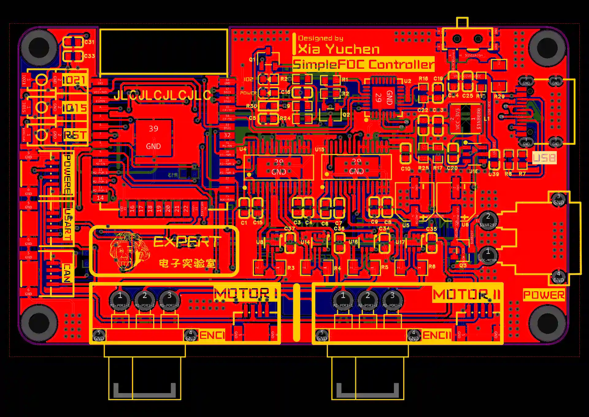
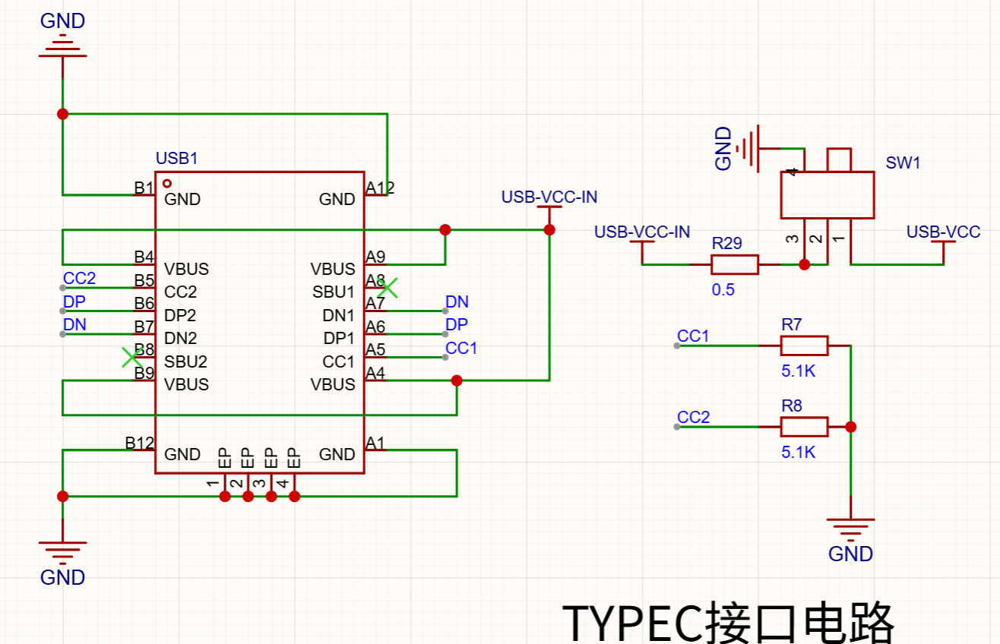
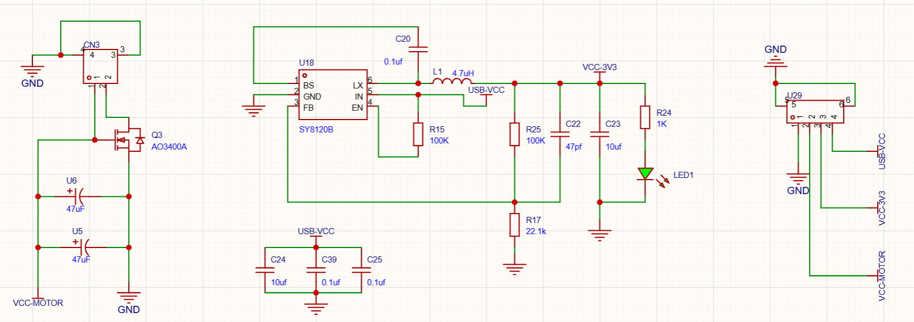
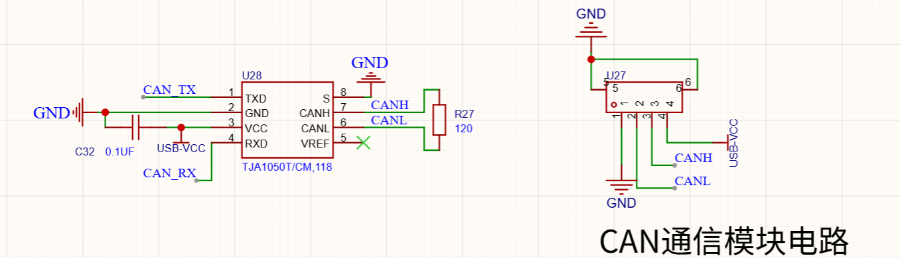
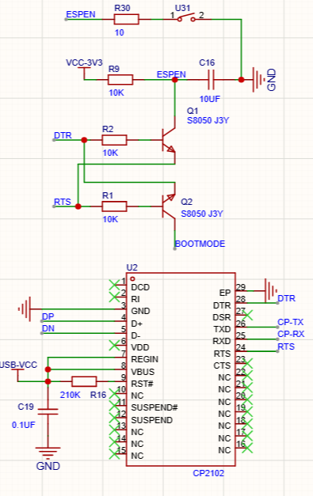
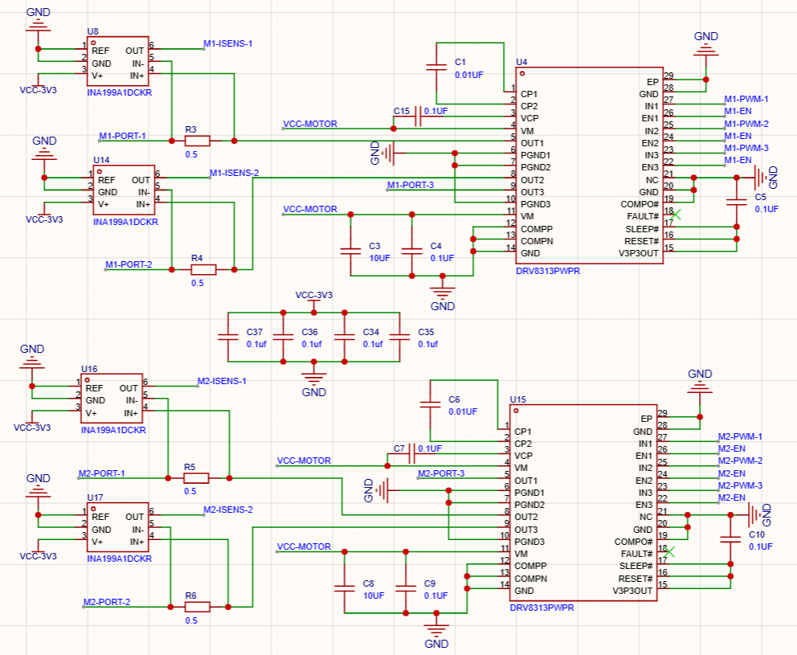
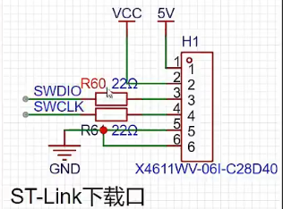
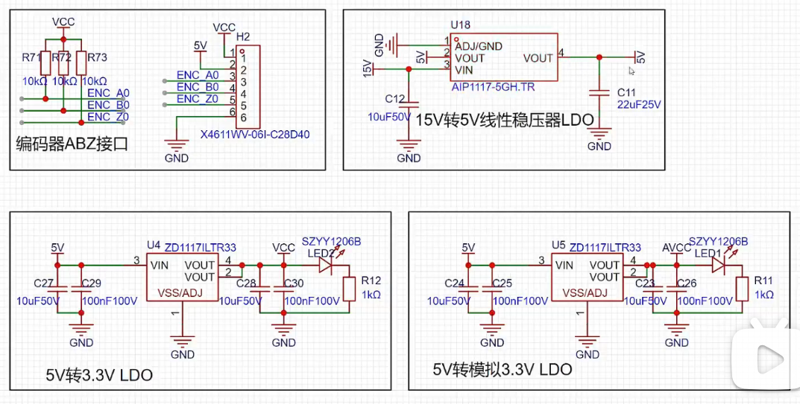
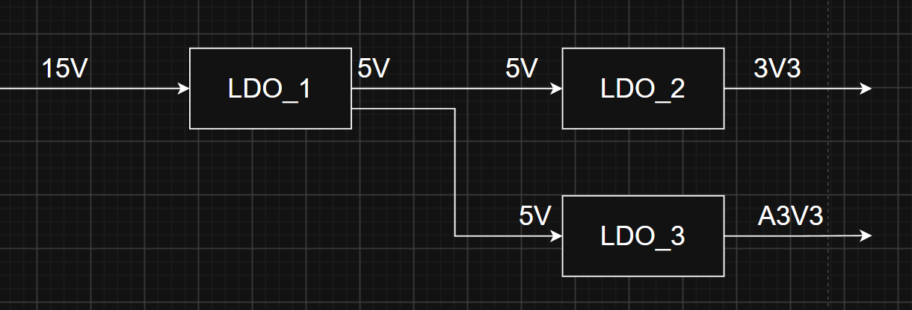
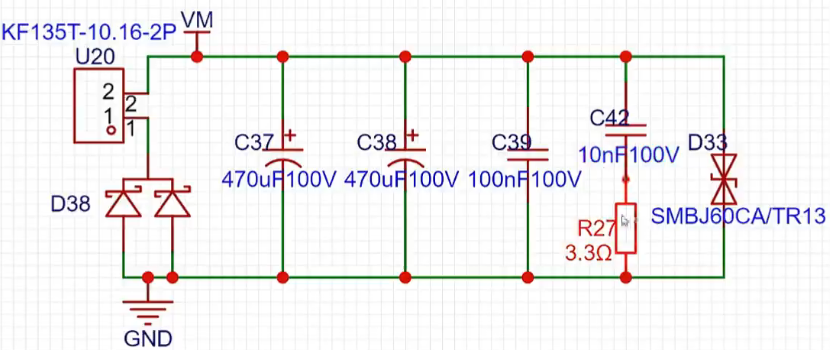

# 一、设计需求
该项目后续需要应用在桌面级轮腿机器人上，需要驱动2个无刷电机，要求驱动板可以支持两路驱动。目前计划使用2208无刷电机，额定12V，0.8A，即最后成品过流>=2A。为方便调试，需要板载一块0.78寸的屏幕。需要有足够丰富的外设资源，至少一路CAN，与上级板进行沟通；两路SPI，读取编码器的数据；此外，一路UART，一路SWD，如果可能，应该有IIC接口。

# 二、同类设计分析
## （一）鲲FOC无刷电机控制器
开源地址：[鲲FOC无刷电机控制器（已适配灯哥开源FOC程序） - 立创开源硬件平台](https://oshwhub.com/expert/xin-shuang-lu-simplefoc-wu-shua-dian-ji-qu-dong-qi-yi-shi-pei-deng-ge-foc-cheng-xu)
尺寸为80mm x 45mm，主控采用ESP32Wroom，资源：两路无刷电机驱动，两路iic，一路can，一路usart接口电路带载能力：供电12V，输出最大电流2A。
### 整体分析
整体上是符合预期的，但是使用ESP32芯片，个人认为芯片的解算能力不足，同时在我自己的设想中，并不需要什么联网的操作，如果真的联网，那也一定是更上层的主控板的内容，ESP32芯片并不符合我的设计。同时，没有调试屏幕。

### 具体分析
#### （1）

采用了TYPEC进行5v供电，同时使用了拨码开关进行了隔离。不过，个人认为仍然需要添加保护电路，防止后级电路电压突变烧毁电脑主板。
#### （2）

功率电源的输入口，使用MOS管进行了防反接保护。但是似乎不够合理，没有采用栅极上拉，以及栅极的保护。[硬件设计小知识](../../../小知识/硬件设计小知识.md)
DCDC降压芯片采用SY8120B，相比于我常用的MP2315s，输入电压范围要小一些，最大输出电流也只有2A，但是对于本项目来说完全足够，同时我应该吸收，因为它的设计中外围电路比我的要精简许多。
有意思的是设计了一个电源转换电路。观察PCB板的走线，推测用途是给每一种电源都添加了一个外置的电源接口，都可以由外部单独供电。值得借鉴。
#### （3）

CAN协议转换芯片采用的是TJA105x系芯片，是NXP公司的成熟产品。大部分芯片都没有内部集成CAN协议转换，因此我需要沿用这个设计。
#### （4）

串口转换电路。这直接与TYPEC的DP、DM相连，将使TYPEC具备直接发送信息给芯片的能力。大部分的PCB设计都是直接引出芯片的tx、rx，需要使用者转接TTL电平串口转换工具。虽然方便调试，但是对于我的项目，需要控制体积，没有这个必要。
#### （5）

电机驱动电路。采用DRV8313PWPR作为电机驱动芯片。INA199A1DCKR作为电流采样芯片。
## （二）不知名网友的设计
获知地址：[网友设计的无刷电机驱动板，主控是STM32，让我帮他看下，历时三天出了这期分析视频_哔哩哔哩_bilibili](https://www.bilibili.com/video/BV1Xo4y1w7zH?spm_id_from=333.788.videopod.sections&vd_source=f463c94bb693bc70ae0b1979f04aa8aa)
### 整体分析
这是一个单路无刷电机驱动，尺寸过大，且资源不足，
### 具体分析
#### （1）

SWD下载电路。在DIO和CLK上添加了22欧电阻。具体原理已收录入[硬件设计小知识](../../../小知识/硬件设计小知识.md)
#### （2）

严重错误的电源路径设计。5V在本设计中后级带的负载并不算很小，一旦负载过大，或者后级不小心短路，LDO_1会直接烧毁，结果短路，进一步影响LDO_2和LDO_3短路，整个电源系统全部摧毁。
对于高压宽脉冲电流，即使添加TVS也并不能保证系统的稳定，需要重构电源路径。
#### （3）

RC滤波电路。这是本人第一次真正见到在设计中使用RC震荡进行滤波。