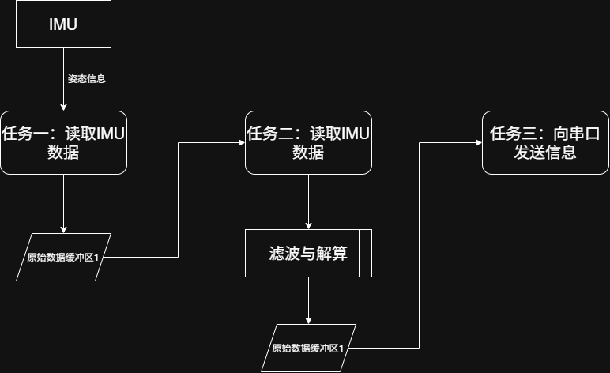

# 目录
一、项目初始化配置

# 项目的初始化
1. RCC时钟源 设置，高速和低速时钟全部使用外部晶振。

2. SYS下，Debug模式设置为Serial Wire串行总线调试；由于项目要求使用Freertos，故给系统设置时基源，选择不常用的TIM14。

3. Freertos软件API标准选择为CMSIS_V2。

4. 开发环境选择为CMake

# 二、软件设计
## （一）工作流程

## （二）任务拆解
### 任务一：读取IMU数据
[MPU-6050 -PDF数据手册-参考资料-立创商城](https://item.szlcsc.com/datasheet/MPU-6050/24852.html?spm=sc.gbn.xds.a___sc.gbn.hd.ss&c=BD&sdclkid=ALfi15fG15fNAJDib-&bd_vid=8182337746235296236&lcsc_vid=QwMKBgBfEwdWBlRXElgKUlVQEQNYAQVfE1dbVgUDFFYxVlNfRlhaU1FfT1BeVzsOAxUeFF5JWA8aF0oLBA9ABApJ)
本项目选择的IMU芯片为MPU6050，根据数据手册信息，该芯片采用IIC通信。

